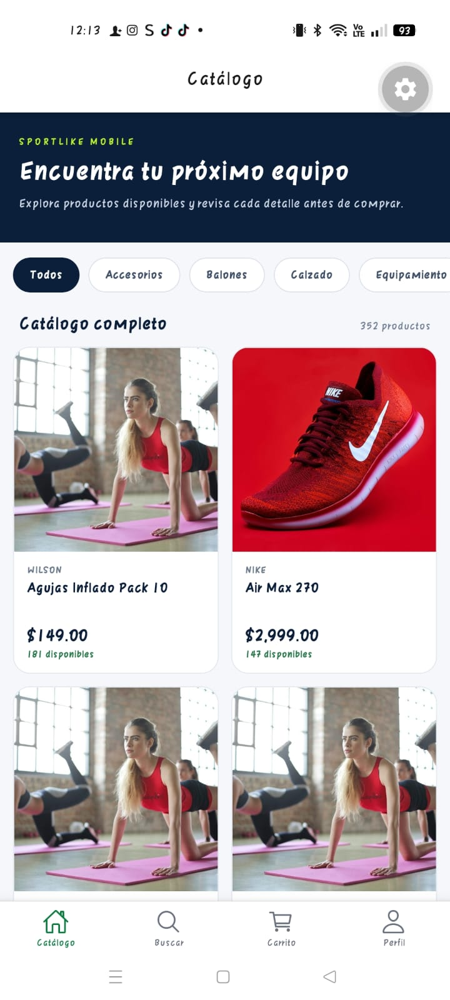
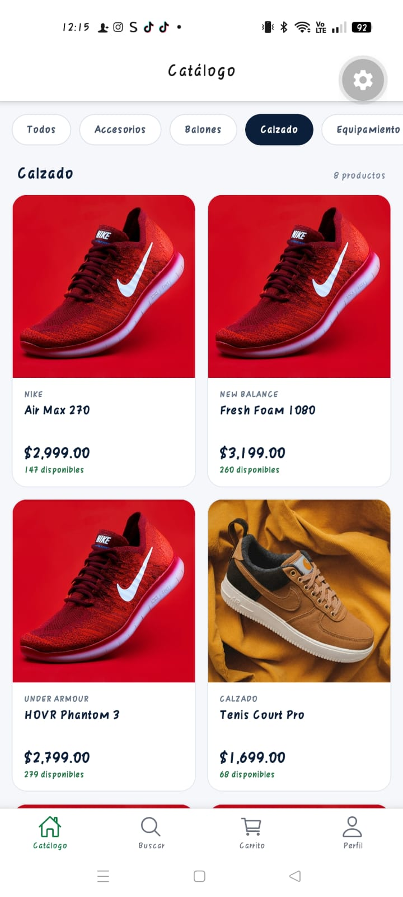
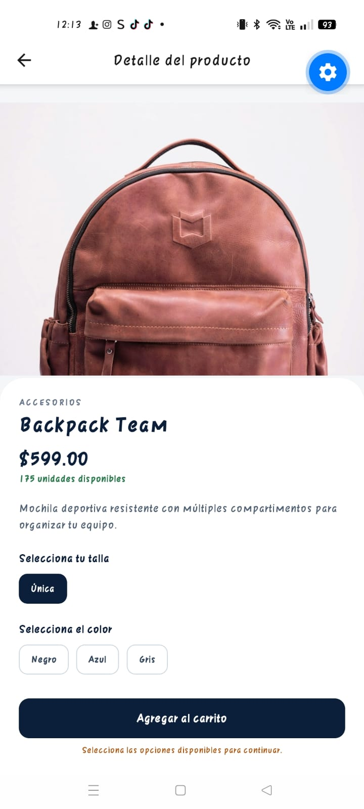

# Evidencia de aceptación — HU3 #9 SportLike Mobile

**Proyecto:** SportLike Mobile  
**Historia de usuario:** HU3 #9 — Carga progresiva de imágenes y paginación del catálogo  
**Fecha de las capturas:** 18 de octubre de 2026  
**Modalidad:** Comprobación manual en teléfono Android con la aplicación ejecutada desde Expo  
**Responsable de la comprobación:** Montse Alvarez  
**Dispositivo (modelo):** No registrado  
**Conexión de red:** No registrada

## Objetivo

Verificar en un teléfono que el catálogo se visualice y permita cargar más productos al desplazarse, filtrar por categoría y consultar el detalle de un producto.

## Resultados observados

| Caso | Acción / condición | Evidencia / observación | Resultado |
|---|---|---|---|
| AC-01 | Abrir SportLike y entrar al catálogo | Se observa el catálogo con el contador «352 productos» | Aprobado |
| AC-02 | Consultar las tarjetas | Se visualizan imágenes, nombres, precios y existencias | Aprobado |
| AC-03 | Desplazarse hacia abajo | La persona que realizó la prueba confirmó que aparecen más productos e imágenes al deslizar | Aprobado (observación reportada) |
| AC-04 | Seleccionar «Calzado» | Captura con el filtro activo y contador «8 productos»; las tarjetas corresponden a calzado | Aprobado |
| AC-05 | Regresar a «Todos» | Se confirmó que vuelve el catálogo completo con 352 productos y se pueden seguir viendo productos al deslizar | Aprobado (observación reportada) |
| AC-06 | Abrir un producto | Captura de la pantalla de detalle con imagen, precio, existencias y opciones | Aprobado |

## Capturas

**Catálogo general** — inicio del catálogo, imágenes y contador de productos.

**Filtro «Calzado»** — categoría activa y listado filtrado.

**Detalle del producto** — pantalla que aparece al abrir una tarjeta.

## Alcance y limitaciones

- Las capturas acreditan estados visibles; la aparición de productos adicionales y el regreso a «Todos» fueron confirmados por la persona que realizó la prueba, sin grabación de pantalla adjunta.
- No se midió el número de imágenes descargadas, solicitudes de red ni uso de memoria.
- Las capturas por sí mismas no permiten demostrar que exactamente ocho productos fueron renderizados antes del primer desplazamiento; esa lógica fue comprobada en pruebas automatizadas.
- No se verificó el comportamiento en diferentes dispositivos, redes o condiciones sin conexión.

## Conclusión

**Resultado de aceptación: satisfactorio para los seis escenarios revisados en el teléfono.** La experiencia observada coincide con el funcionamiento esperado de las tarjetas, filtros, navegación y visualización progresiva de productos. Esto no equivale a una certificación de rendimiento o compatibilidad general.

**Referencia de integración continua:** PR [#105](https://github.com/SaulGaspar/DevOps/pull/105). Las pruebas automatizadas de esta ejecución reportaron 61/61 casos aprobados; este documento registra únicamente la comprobación manual.
